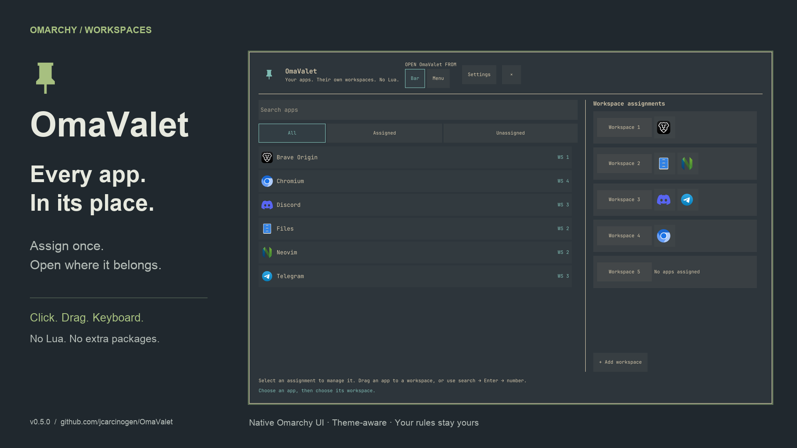
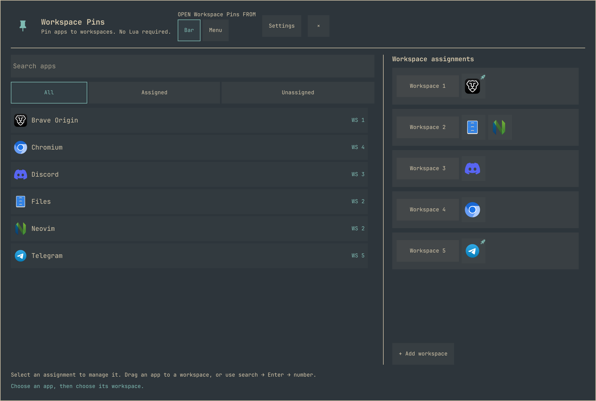
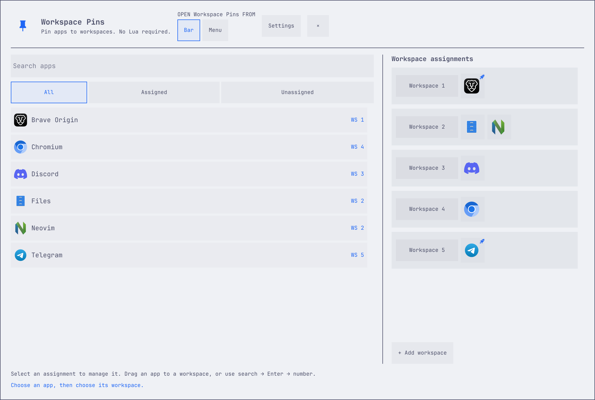

# OmaValet

[](https://x.com/scottito22)

**Your apps. Their own workspaces. No Lua.**

Keep your browser on 1, your editor on 2, and chat on 3. Choose an app and where it belongs; **newly opened windows** go there. Start apps at login only when you choose. OmaValet follows your Omarchy theme, respects existing rules, and opens from the bar or menu. No extra packages. No sudo or pkexec is required.

Keep your favourite workspace switcher: OmaValet decides where apps open, rather than replacing the overview. Existing windows are not moved, and this is not a session-restoration tool.



## Features

- Search installed desktop applications by name, including Omarchy **Agent** (`Super+Ctrl+Shift+A`).
- Start with quick bar access, then switch between **Bar** and **Menu** with the **Open OmaValet from** toggle in OmaValet's header.
- See five workspace parking lanes at a glance, matching Omarchy's default.
- Park more than one app in the same workspace; see recognizable app icons in each lane, with names on hover.
- Add extra workspaces with **+ Add workspace** (up to 10), and remove empty extras with **− Remove workspace** down to five.
- Click an app then its workspace, drag an app between lanes, or search → **Enter** → **1–9** (**0** for 10).
- Filter All / Assigned / Unassigned; use **+N more** to reach every app in a crowded lane.
- Persistent success/error feedback, **Retry** after an apply failure, and single-level **Undo**.
- **Identify window** explicitly learns a running app’s real class without displaying or saving window titles.
- **Open to test** launches only when requested; single-instance apps may activate an existing window.
- Opening a parked app switches to its workspace. **Start at login** is optional, off by default, and silent so it does not steal the current workspace.
- See existing Hyprland assignments as locked, read-only entries.
- Select an assigned app to change **Start at login** or **Remove** its assignment; removing never uninstalls the app.
- **Esc** backs out of a dialog, clears search/selection, then closes. **Ctrl+F** returns to search.
- A rare, silent Claudia cameo celebrates your first three applied assignments. Settings can disable celebrations or use a still image for reduced motion; double-click the logo to replay.
- Match real window classes from StartupWMClass, desktop id, and Flatpak `--command=` so apps land on the right workspace.
- Follow the active Omarchy theme through its native `Color`, `Style`, and `Border` tokens.
- Generate deterministic Hyprland Lua without rewriting `autostart.lua`.
- Back up `hyprland.lua` before adding the reversible loader block. Writes are atomic and do not follow planted symlinks; reset never restores a stale backup over later edits.

## Screenshots

Actual native QML captures of v0.5.0 with fictional assignments, not a UI mockup. The header and bar use the pin glyph.

### Everforest



### Catppuccin Latte



## Requirements

- Omarchy Quattro (Omarchy 4)
- Python 3 (standard library only)

No extra packages and no second Quickshell process. No sudo or pkexec is required. Installing the plugin does not write Hyprland config; parking an app does, and only after you click.

## Install

```bash
omarchy plugin add https://github.com/jcarcinogen/OmaValet.git --enable
```

OmaValet appears on the right side of the Omarchy bar by default. Click its icon to open the parking board. When setup is finished, choose **Menu** under **Open OmaValet from** to remove the bar icon and add OmaValet to the root command menu at **Super+Space → OmaValet**.

Switching to menu access installs this action:

```bash
omarchy-shell shell toggle io.github.jcarcinogen.omavalet
```

## Use

1. Open **OmaValet** from its bar icon. If you previously chose menu access, press **Super+Space** and choose **OmaValet** instead.
2. Use **Open OmaValet from → Bar / Menu** in the header whenever you want quick access or a less cluttered bar.
3. Search for and select an application.
4. Click a **Workspace N** button, drag the app into a lane, or press **Enter**, then the workspace number. Digits in search remain ordinary text.
5. Extra workspaces can be added up to ten and removed only when the last extra lane is empty.
6. Select an assigned app, including through **+N more**, to change **Start at login**, **Open to test**, **Identify window**, or **Remove**.
7. Read the result in the footer. A saved-but-not-applied change offers **Retry**; **Undo** restores the last assignment change.
8. Press **Esc** to back out and close.

Locked entries come from existing user-authored Hyprland rules. OmaValet shows them for context but does not overwrite or remove them.

## What OmaValet writes

OmaValet does not edit `~/.config/hypr/autostart.lua`. Placement is the default; login launch is opt-in:

- `~/.config/omarchy/omavalet.json` — OmaValet-owned assignments, one undo checkpoint, preferences and the one-time celebration milestone
- `~/.config/omarchy/omavalet.lock` — a regular-file lock preventing simultaneous writes
- a marked `OmaValet` entry in `~/.config/omarchy/extensions/omarchy-menu.jsonc`, with a first-write `omarchy-menu.jsonc.omavalet.bak`, while **Menu** access is selected
- either a right-side bar entry or a top-level overlay entry in `~/.config/omarchy/shell.json`, with a first-write `shell.json.omavalet.bak`; the toggle moves the same entry instead of creating duplicates
- `~/.config/hypr/omavalet.lua` — generated `o.window(...)` rules (follow the workspace on a normal launch). When **Start at login** is on, also `o.exec_on_start("[workspace N silent] uwsm-app -- …")`
- `~/.config/hypr/hyprland.lua.omavalet.bak` — first-write backup
- a marked `require("hypr.omavalet")` block in `~/.config/hypr/hyprland.lua`

Parked apps go to their workspace when you open them. They start at login only if you turn **Start at login** on, and that start is silent.

## Remove

Reset OmaValet first so its generated state and marked loader are removed safely:

```bash
PLUGIN_DIR="$HOME/.config/omarchy/plugins/io.github.jcarcinogen.omavalet"
python3 "$PLUGIN_DIR/scripts/omavalet.py" reset
omarchy plugin remove io.github.jcarcinogen.omavalet
```

If reset reports `"backupPreserved": true`, OmaValet detected that the current Hyprland configuration no longer matches its original backup. The backup is deliberately left at:

```text
~/.config/hypr/hyprland.lua.omavalet.bak
```

Review it before deleting it. Reset never replaces later user changes with the backup. Reset retains an empty assignment state with Undo, preferences and the celebration milestone; remove `~/.config/omarchy/omavalet.json` and `omavalet.lock` yourself after uninstall if you want to forget these too.

## Development

Run the Python tests:

```bash
python3 -m unittest discover -s tests -v
```

Validate the plugin on Omarchy:

```bash
omarchy plugin validate .
```

On a machine with Omarchy, Quickshell and QtTest already installed:

```bash
python3 tests/run_native.py           # isolated offscreen Qt + backend integration
python3 tests/run_native.py --wayland # also briefly shows/closes the real overlay
```

The harness uses its own cache HOME and explicit compositor/app-launcher doubles. The Wayland test exercises the actual layer-shell window and verifies input-layer cleanup, but does not apply test assignments to the user’s compositor. No packages are installed. Logs and native captures are saved in the printed cache directory.

The plugin id is `io.github.jcarcinogen.omavalet`.

For repeatable, privacy-clean native screenshots on an Omarchy machine with an active desktop session:

```bash
python3 tests/capture_preview.py --output-dir examples
```

The capture harness runs Qt offscreen with isolated configuration and fictional assignments; GTK uses the existing display only to resolve native icon themes. It does not change the desktop theme or assignments. `tools/build_preview.py` composes the marketplace image from the native capture; its developer-only dependency is Pillow, not a plugin runtime requirement. See `--help` for font paths.

## Current scope

- Workspaces 1–5 are shown by default, matching Omarchy. Extra lanes appear if you already park there, or when you click **+ Add workspace** (up to 10). Empty extras can be removed down to five.
- Existing assignments found in `hyprland.lua` and `windows.lua` are read-only.
- Application identity comes from freedesktop desktop files plus live class aliases (StartupWMClass, desktop stem, Flatpak `--command=`). Omarchy Agent is included even without a `.desktop` launcher.

## License

Source code: MIT. Claudia media: creator-provided character-use terms; see [asset provenance and credits](assets/README.md).
